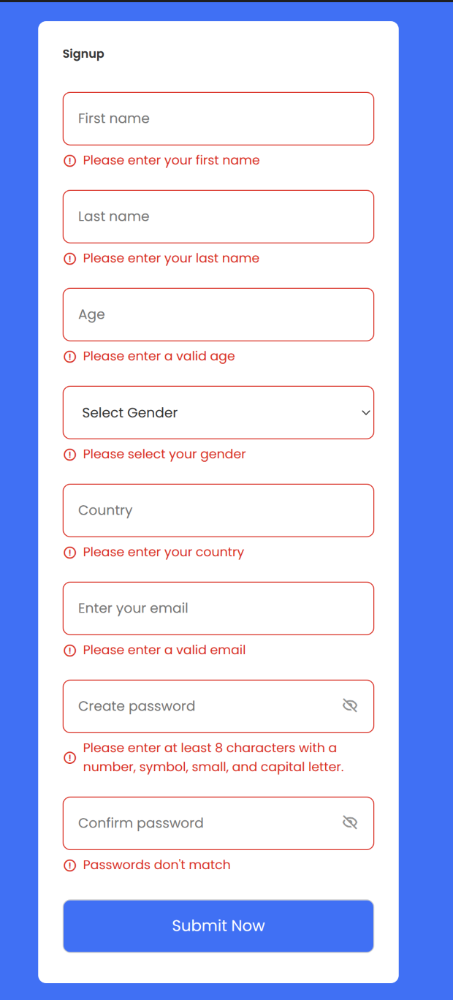
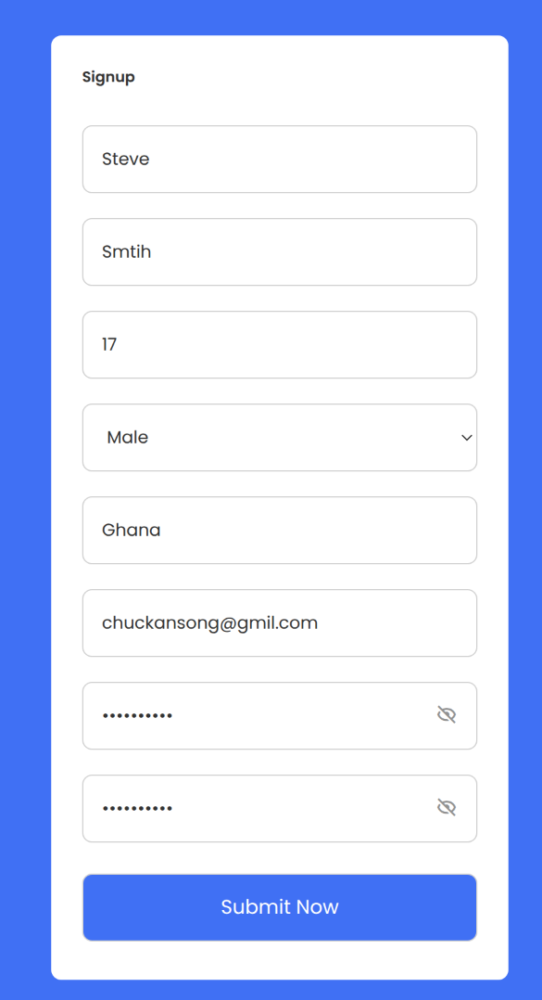
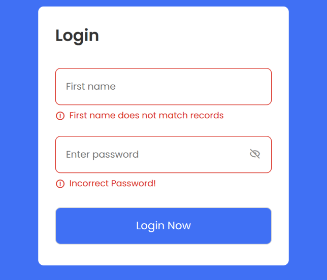

## About This Project
A lightweight, client-side **User Registration and Login System** built with HTML, CSS, and vanilla JavaScript. It features real-time form validation, dynamic error messaging, password visibility toggles, and browser-based authentication using `localStorage`

## How It Works
1. **Signup (`index.html`):** Validates user inputs—including Regex checks for email format and password strength—and highlights invalid fields in real time. Once valid, it saves the user's first name and password to `localStorage` and redirects to the login page
2. **Login (`login.html`):** Checks the entered credentials against the values stored in `localStorage`. If they don't match, field-specific errors appear; if they match, the user proceeds to the next screen.
3. **Welcome (`welcome.html`):** Greets the authenticated user by their registered first name

# Screenshots

